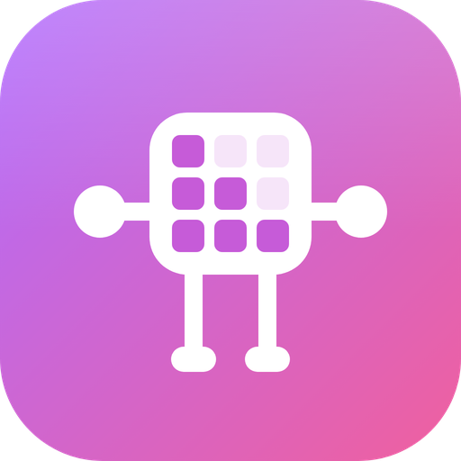

## 关于我

我是纳米，北邮毕业，百度实习，校招腾讯，做了多年后端工程师和面试官。目前正在学习 LLM 和 Agent，大多数时间都在 [𝕏](https://x.com/antiAIvo) 上。

## 📚 大模型教程

两个开源项目，从模型本身学到模型外面那一圈。每个仓库里都有对应的图文教程和可视化链接，全部内容也在 **[namiai.tech](https://namiai.tech/)**。

**[NamiGPT](https://github.com/aa1143/NamiGPT)**：零基础入门大模型（LLM）的基础教程。 
用 PyTorch 从零手写 GPT-2，加载 OpenAI 官方权重，跑通推理和文本生成。共 15 篇图文，每篇都配可运行的代码。

 

**[NamiAgent](https://github.com/aa1143/NamiAgent)**：零基础入门 AI Agent 的基础教程。 
不只是教程，也是一个能在本地跑起来的 Agent，自带网页端。从 100 行的最小循环开始，一课加一个能力，最后拆解 Claude Code、Codex 等主流 Agent。

 

## 🛠 开源项目

### 🧰 小工具

**[CamWindow](https://github.com/aa1143/CamWindow)**：一个极简的 macOS 悬浮摄像头窗口，专为录屏教程设计。 
它能从 16:9 画面的中心裁出 3:4、9:16 或 1:1 的竖屏，不拉伸、不变形，窗口无边框、带圆角、始终置顶，用原生 Swift 单文件写成。

 

### 🤖 Agent

- **[tiny_openclaw](https://github.com/aa1143/tiny_openclaw)**：网页版的轻量 AI Agent 平台，支持可视化编排 Skill、串行或并行执行，并实时展示每一步。

### 🧩 Skill

- **[knowledge-media-cover](https://github.com/aa1143/knowledge-media-cover)**：知识类自媒体的封面 Skill。暖象牙色纸底、大标题、暗红色标签，只要提供分类和标题，就能生成一套统一风格的封面。
- **[engraved-knowledge-cover-skill](https://github.com/aa1143/engraved-knowledge-cover-skill)**：黑白雕刻风格的知识封面 Skill。用一个思想隐喻表达主题，适合做公众号封面和文章头图。

## 找到我

[个人网站](https://namiai.tech/) · [X](https://x.com/antiAIvo) · [Email](mailto:814185384@qq.com)
