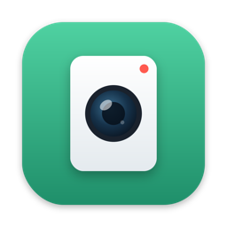

## About

我是纳米，后端工程师，正在学习 LLM 和 Agent。 
我把学到的东西写成教程，也动手做一些实用的小工具。

## 📚 大模型教程

全部教程都在 **[namiai.tech](https://namiai.tech/)**，建议按这个顺序学：

1. **[大模型学习路线图](https://namiai.tech/map/)**：先看全景， 
   从 Transformer 到 DeepSeek-V4，分成 8 个阶段、51 个知识点。
2. **[图解大模型](https://namiai.tech/matrix/)**：用「猫吃鱼」3 个词，一格一格地算矩阵。
   - [大模型是怎么推理的](https://namiai.tech/matrix/)
   - [大模型是怎么训练的](https://namiai.tech/training/)
   - [Agent 是怎么工作的](https://namiai.tech/agent/)
3. **[从零手写大模型](https://namiai.tech/articles/)**：用代码把大模型复现一遍，从 GPT-2 写到 LLaMA，再到 DeepSeek。 
   包括推理篇 15 讲、训练篇 5 讲、从 GPT-2 到 LLaMA 5 讲、从 LLaMA 到 DeepSeek 2 讲。
4. **[大模型论文研读](https://namiai.tech/papers/)**：读原始论文，目前有 Attention Is All You Need 的动态架构图， 
   以及 Switch Transformer（MoE）的三篇解读。

## 🛠 开源项目

### 📖 教程

**[NamiGPT](https://github.com/aa1143/NamiGPT)**：零基础入门大模型的 LLM 基础教程。 
用 PyTorch 从零手写 GPT-2，加载 OpenAI 官方权重，跑通推理和文本生成。 
共 15 篇图文，每篇都配可运行的代码。

 

### 🧰 小工具

**[CamWindow](https://github.com/aa1143/CamWindow)**：一个极简的 macOS 悬浮摄像头窗口，专为录屏教程设计。 
它能从 16:9 画面的中心裁出 3:4、9:16 或 1:1 的竖屏，不拉伸、不变形， 
窗口无边框、带圆角、始终置顶，用原生 Swift 单文件写成。

 

### 🤖 Agent

- **[tiny_openclaw](https://github.com/aa1143/tiny_openclaw)**：网页版的轻量 AI Agent 平台， 
  支持可视化编排 Skill、串行或并行执行，并实时展示每一步。

### 🧩 Skill

- **[knowledge-media-cover](https://github.com/aa1143/knowledge-media-cover)**：知识类自媒体的封面 Skill。 
  暖象牙色纸底、大标题、暗红色标签，只要提供分类和标题，就能生成一套统一风格的封面。
- **[engraved-knowledge-cover-skill](https://github.com/aa1143/engraved-knowledge-cover-skill)**：黑白雕刻风格的知识封面 Skill。 
  用一个思想隐喻表达主题，适合做公众号封面和文章头图。

## Contact me

[个人网站](https://namiai.tech/) · [X](https://x.com/antiAIvo) · [Email](mailto:814185384@qq.com)
